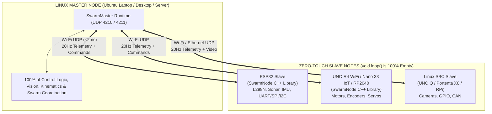

# OpenSwarm — Software for Wireless Autonomous Robot Management

<p align="center">
  <a href="https://pypi.org/project/openswarm-master/"></a>
  <a href="https://pypi.org/project/openswarm-slave/"></a>
  <a href="https://github.com/raihhann/OpenSwarm/tree/SwarmNode"></a>
  
  
</p>

> **Flash Once. Declare Pins. Never Reprogram the Robot Again.**  
> **OpenSwarm** is a lightweight, hardware-agnostic **Distributed Hardware Abstraction Layer (Remote HAL)** for multi-robot swarms. Inspired by [Klipper](https://www.klipper3d.org/), OpenSwarm strips **100% of control logic out of the slave microcontrollers** (`void loop()` is completely empty) and moves all sensor processing, state machines, kinematics, and multi-robot coordination to a central **Linux Master** over low-latency Wi-Fi UDP.

### Official Packages
* **Central Master SDK (PyPI):** [`openswarm-master`](https://pypi.org/project/openswarm-master/) — install via `pip install openswarm-master`
* **Linux SBC Slave Agent (PyPI):** [`openswarm-slave`](https://pypi.org/project/openswarm-slave/) — install via `pip install openswarm-slave` (for **Arduino UNO Q**, **Portenta X8**, **Raspberry Pi**, **Jetson**, and **Linux PCs**)
* **Arduino / PlatformIO Slave Library:** [`SwarmNode`](https://github.com/raihhann/OpenSwarm/tree/SwarmNode) — install in Arduino IDE or PlatformIO (`raihann/SwarmNode`) for Wi-Fi boards: **ESP32**, **RP2040** (Nano RP2040 Connect / Pico W), **Arduino UNO R4 WiFi / UNO WiFi Rev2**, and **Arduino Nano 33 IoT**

---

## Live Hardware Demo: Linux Master Controlling ESP32 Slave Over Wi-Fi

<p align="center">
  <a href="assets/demo_esp32_led.mp4">
    
  </a>
  <br />
  <em>Click the animation above (or <a href="assets/demo_esp32_led.mp4">open <code>assets/demo_esp32_led.mp4</code></a>) to watch the full demo video.</em>
</p>

In the demo above:
1. The **ESP32 Slave (`esp32_node`)** only declares its Wi-Fi credentials, Node ID, and GPIO Pin `2` (`"led"`) inside `setup()`. Its `void loop()` is **100% empty**.
2. A background FreeRTOS daemon on Core 0 automatically advertises the node on UDP Port `4211` and streams live 20 Hz Wi-Fi RSSI telemetry on UDP Port `4210`.
3. The **Linux Master (`openswarm-master`)** connects over Wi-Fi (`192.168.0.118`), receives live 20 Hz sensor telemetry, and toggles GPIO `2` in real time.

## Local 3D Demo (No Hardware)

Install the master package with its optional demo dependency, then run
[`launch_demo.bat`](./launch_demo.bat) on Windows or
[`launch_demo.sh`](./launch_demo.sh) on Linux/macOS:

```bash
python -m pip install -e "master[demo]"
```

The demo serves on `http://localhost:8080` and starts virtual ESP32/RP2040 nodes.
The UDP control protocol is unauthenticated and unencrypted; use real hardware
only on a trusted, isolated network. The browser demo binds to localhost only.

---

## Why OpenSwarm? (How It Complements ROS 2)

Building a heterogeneous micro-robot swarm (mixing small Wi-Fi Arduinos, 32-bit ESP32/RP2040 boards, and Linux SBCs) with standard tools hits three major walls:

| Challenge | Standard `micro-ROS` / `ros2_control` | **OpenSwarm (`SwarmNode` + `SwarmMaster`)** |
| :--- | :--- | :--- |
| **Small / Low-RAM Boards** | Struggles on small Arduinos (requires a micro-ROS agent, RTOS and plenty of RAM) | **Runs on small Wi-Fi boards** — from a 6 KB RAM UNO WiFi Rev2 to ESP32/RP2040 and Linux SBCs |
| **Where Does Logic Live?** | Distributed across C/C++ firmware on every robot (requires recompiling & reflashing to change behavior) | **0% control logic on Slaves.** `void loop()` is empty; 100% of logic runs in Python on the Linux Master |
| **Adding Sensors / Buses** | Requires custom C++ `hardware_interface` plugins, URDFs, and firmware rebuilds | **1-line pin/bus declaration** (`L298N`, `Ultrasonic`, `MPU6050`, `SPI`, `I2C`, `UART`, or Custom Hook) |
| **Safety** | Manual implementation per node | Built-in **500 ms software transport watchdog** on every Slave automatically stops motors if Master disconnects |

---

## System Architecture



---

## How It Works: Side-by-Side Code

### 1A. On a Microcontroller Slave (`ESP32` / `RP2040` — Flashed Once)
```cpp
#include <SwarmNode.h> // Or: #include <OpenSwarm.h>

SwarmNode node("esp32_node");

void setup() {
    // 1. Connect to Wi-Fi
    node.connectWiFi("YOUR_WIFI_SSID", "YOUR_WIFI_PASSWORD");

    // 2. Declare attached hardware pins ONLY — Zero Control Logic!
    node.registerDigitalOutput("led", 2);                 // Onboard LED on GPIO 2
    node.registerL298N("drive", 14, 27, 26, 32, 25, 33);  // Dual H-Bridge Motor Driver
    node.registerUltrasonic("front_sonar", 5, 18);        // HC-SR04 Ultrasonic Sensor
    node.registerOnboardIMU("imu");                       // Built-in 6-Axis IMU (on Nano RP2040 Connect)
    node.registerWiFiRSSI("rssi");                        // Onboard Wi-Fi RSSI (dBm)

    // 3. Start the background RTOS daemon or board-specific loop hook
    node.start();
}

void loop() {
    // 100% EMPTY! All control happens remotely from the Linux Master.
}
```

### 1B. On a Linux SBC Slave (`Arduino UNO Q` / `Portenta X8` / `Raspberry Pi` / `Jetson`)
```python
from openswarm_slave import SwarmNode

node = SwarmNode("portenta_x8")

# Declare attached hardware pins/sensors ONLY — Zero Control Logic!
node.register_digital_output("led", 2)
node.register_l298n("drive", 14, 27, 26, 32, 25, 33)
node.register_cpu_temp("cpu_temp")
node.register_system_load("sys_load")
node.register_wifi_rssi("rssi")

node.start()
```

### 2. On the Linux Master (`Python` — Where 100% of Control Lives)
```python
import time
from openswarm import SwarmMaster

master = SwarmMaster()

# Auto-discovers 'esp32_node' on Wi-Fi (or pass ip='192.168.0.118')
bot = master.connect("esp32_node")

while True:
    # Read live 20 Hz sensor telemetry streamed from the Slave
    dist = bot.read("front_sonar")
    rssi = bot.read("rssi")
    print(f"Distance: {dist:.1f} cm | RSSI: {rssi:.0f} dBm")

    # Send real-time actuator & pin commands over UDP
    if dist > 20.0 or dist < 0:
        bot.digital_write("led", 1)
        bot.drive("drive", left=180, right=180)
    else:
        bot.digital_write("led", 0)
        bot.stop()

    time.sleep(0.05)
```

---

## Supported Hardware, Sensors, Actuators & Bus Protocols

OpenSwarm supports both dedicated 1-line robotics drivers and **universal bus passthroughs (`SPI`, `I2C`, `UART`, and Custom Callbacks)** so you are never limited by pre-baked sensors:

### Actuators
| API Method | Hardware / Protocol | Master Python Call |
| :--- | :--- | :--- |
| `registerL298N(name, ena, in1, in2, enb, in3, in4)` | 6-pin Dual H-Bridge DC Motor Driver | `bot.drive(name, left, right)` |
| `registerDRV8833(name, in1, in2, in3, in4)` | 4-pin Dual H-Bridge DC Motor Driver | `bot.drive(name, left, right)` |
| `registerMotor2Pin(name, pinA, pinB)` | Single Reversible DC Motor | `bot.drive(name, speed)` |
| `registerServo(name, pin)` | 50 Hz Hobby Servo (`0°–180°`) | `bot.servo(name, angle)` |
| `registerStepper(name, stepPin, dirPin, enPin)` | Stepper Driver (`A4988`, `DRV8825`, `TMC2209`) | `bot.stepper(name, steps, delay_us)` |
| `registerDigitalOutput(name, pin)` / `registerPin()` | GPIO Output (LED, Relay, Solenoid, Buzzer) | `bot.digital_write(name, 1)` |
| `registerPWMOutput(name, pin)` | Variable PWM Output (`0–255`) | `bot.pwm_write(name, duty)` |
| `registerDACOutput(name, pin)` | True Analog DAC Output (`GPIO25`/`26`) | `bot.set_actuator(name, val)` |
| `registerI2CActuator(name, i2cAddr, sda, scl)` | Generic I2C Register Writer (`PCA9685`, `MCP23017`) | `bot.write_reg(name, reg, val)` |
| `registerSPIActuator(name, cs, sck, miso, mosi, hz)` | Generic SPI Register Writer | `bot.write_reg(name, reg, val)` |
| `registerUARTActuator(name, rx, tx, baud, uartNum)` | Generic Hardware UART Transmitter (`RS485`, Serial) | `bot.send_bus(name, data="...")` |
| `registerCustomActuator(name, callback)` | Custom User C++ Callback (`loop()` stays empty!) | `bot.send_bus(name, data, v1, v2)` |

### Sensors & Transceivers
| API Method | Hardware / Protocol | Streamed Telemetry (`bot.read(name)`) |
| :--- | :--- | :--- |
| `registerUltrasonic(name, trig, echo)` | `HC-SR04` / `JSN-SR04T` Ultrasonic | Distance in `cm` (`float`) |
| `registerVL53L0X(name, i2cAddr, sda, scl)` | `VL53L0X` I2C Laser ToF Rangefinder | Distance in `mm` (`float`) |
| `registerQuadratureEncoder(name, pinA, pinB)` | Hardware Interrupt Wheel Encoder | Cumulative ticks (`float`) |
| `registerTachometer(name, pin)` | Optical / Hall Speed Sensor | Pulse count (`float`) |
| `registerMPU6050(name, i2cAddr, sda, scl)` | 6-Axis I2C IMU (`MPU6050` Accel + Gyro) | `[ax, ay, az, gx, gy, gz]` (`g`, `deg/s`) |
| `registerLSM6DSOX(name, i2cAddr, sda, scl)` / `registerOnboardIMU(name)` | 6-Axis I2C IMU (Onboard Nano RP2040 Connect / `LSM6DS`) | `[ax, ay, az, gx, gy, gz]` (`g`, `deg/s`) |
| `registerINA219(name, i2cAddr, sda, scl)` | I2C Bus Voltage & Current Monitor | `[voltage_V, current_mA]` |
| `registerDHT(name, pin, model)` | `DHT11` / `DHT22` Temp & Humidity | `[temp_C, humidity_%]` |
| `registerBumper(name, pin, pullup)` | Contact Limit Switch / Microswitch | `1.0` (pressed) or `0.0` |
| `registerIRSensor(name, pin)` / `registerDigitalInput()` | IR Obstacle, Line, PIR, Hall Sensor | `1.0` or `0.0` |
| `registerAnalogInput(name, pin)` / `registerBatteryVoltage()` | 12-bit ADC (Battery, FSR, LDR, Pot) | Raw ADC `0–4095` |
| `registerTouchPin(name, touchPin)` | Capacitive Touch Pin | Touch reading |
| `registerGenericI2C(name, addr, reg, len, sda, scl)` | **Any I2C Sensor** (`BME280`, `BH1750`, etc.) | Register value (`1–4` bytes) |
| `registerSPISensor(name, cs, reg, len, sck, miso, mosi)` | **Any SPI Sensor** (`MAX6675`, `AS5048A`, etc.) | Register value (`1–4` bytes) |
| `registerUARTSensor(name, rx, tx, baud, uartNum)` | **Any UART Sensor / Transceiver** (`LiDAR`, `GPS`, `RS485`) | Parsed float stream |
| `registerCustomSensor(name, callback)` | **Any 3rd-Party Arduino Library** | 20 Hz callback value(s) |
| `registerWiFiRSSI(name)` | Onboard Wi-Fi Signal Strength | Signal in `dBm` |

---

## Installation & Quick Start

### Part 1: Install the `SwarmNode` Slave Library (Arduino IDE & PlatformIO)

#### Option A: Arduino IDE Library Manager
1. In Arduino IDE, open **Tools -> Manage Libraries...** (or click the Library Manager icon).
2. Search for **`SwarmNode`**, select the library by Mohammed Raihan Soniwala, and click **Install**. Choose the latest version when prompted.
3. Open **File -> Examples -> SwarmNode -> ESP32_LED_Test**, enter your Wi-Fi credentials, and click **Upload**.

You can also install it manually from the [**`SwarmNode` branch**](https://github.com/raihhann/OpenSwarm/tree/SwarmNode): download the branch ZIP, then choose **Sketch -> Include Library -> Add .ZIP Library...**.

#### Option B: PlatformIO (`platformio.ini`)
```ini
lib_deps =
    raihann/SwarmNode@^0.4.1
```

---

### Part 2: Install the `openswarm-slave` Package (PyPI — For Linux SBC Slaves)

[**View `openswarm-slave` on PyPI →**](https://pypi.org/project/openswarm-slave/)

```bash
# Install on Arduino UNO Q, Portenta X8, Raspberry Pi, Jetson, or Linux PC:
pip install openswarm-slave

# Launch a Linux Slave node directly from terminal:
openswarm-slave --id portenta_x8 --led-pin 2
```

---

### Part 3: Install the `openswarm-master` Package (PyPI — Central Master)

[**View `openswarm-master` on PyPI →**](https://pypi.org/project/openswarm-master/)

```bash
# Install directly from official PyPI:
pip install openswarm-master
```

#### Test from Your Linux Terminal:
```bash
# 1. Auto-discover all active Slave nodes on Wi-Fi:
openswarm scan

# 2. Blink GPIO 2 ("led") on your ESP32 and stream live 20 Hz RSSI telemetry:
openswarm blink esp32_node --ip 192.168.0.118
```

---

## Repository Structure

```text
OpenSwarm/
├── assets/
│   ├── demo_esp32_led.gif          # Inline hardware demo animation
│   └── demo_esp32_led.mp4          # Full hardware demo video
├── slaves/
│   ├── arduino/
│   │   └── SwarmNode/              # C++ Arduino Slave Library (synced to `SwarmNode` branch)
│   │       ├── library.properties
│   │       ├── keywords.txt
│   │       ├── src/
│   │       │   ├── SwarmNode.h
│   │       │   ├── OpenSwarm.h
│   │       │   ├── SwarmNode.cpp
│   │       │   ├── SwarmTypes.h
│   │       │   └── hal/
│   │       │       ├── hal_esp32.h     # ESP32 / S2 / S3 / C3 HAL
│   │       │       ├── hal_rp2040.h    # Arduino Nano RP2040 Connect / Pico W HAL
│   │       │       ├── hal_uno.h       # Arduino UNO R4 WiFi / UNO WiFi Rev2 HAL
│   │       │       └── hal_nano.h      # Arduino Nano 33 IoT HAL
│   │       └── examples/
│   │           ├── ESP32_LED_Test/
│   │           ├── ESP32_SlaveNode/
│   │           ├── ESP32_CustomProtocols/
│   │           ├── RP2040_LED_Test/
│   │           ├── RP2040_SlaveNode/
│   │           ├── UNO_SlaveNode/
│   │           └── Nano_SlaveNode/
│   └── linux/                      # Linux SBC Slave Agent (UNO Q, Portenta X8, Raspberry Pi)
├── master/                         # Central Linux Master Python SDK & CLI (`openswarm-master`)
│   ├── pyproject.toml
│   ├── openswarm/
│   │   ├── web_server.py           # Optional browser 3D fleet demo
│   │   └── virtual_slave.py        # Protocol-compatible hardware emulator
│   └── examples/
│       └── blink_esp32_led.py
└── 3Dmodels/                       # Printable robot chassis, wheels, camera stand & renders
```

---

## Framework architecture and current behavior

The master owns application planning; nodes own hardware access. Keep timing-sensitive
drivers and fault supervision local to the node rather than relying on Python or Wi-Fi
timing. An empty sketch `loop()` is a convenience, not a real-time guarantee.

* **Discovery is passive.** `discover_all()`, `nodes`, and `get()` observe nodes without
  sending keepalives or STOP. `connect()` waits for actual telemetry; `subscribe(id)`
  explicitly starts telemetry without blocking. Sending an actuator command also
  activates that node. `close()` and `stop_all()` affect active nodes only; use
  `stop_all(include_discovered=True)` only when that broader action is intended.
  This is local session bookkeeping, not exclusive ownership between masters.
* **Freshness is explicit.** `is_online` requires a received packet; elapsed times use
  a monotonic clock. Use `node.read("sensor", default=None, max_age=0.25)` to reject
  stale telemetry. `node.sensor_errors` reports Linux sensor callback failures;
  failed readings are omitted rather than retained in the next sample.
* **Drivers expose limitations.** Linux supports dependency injection through
  `SwarmNode(..., hal=...)`, with `LinuxHAL(backend="sim")` for hardware-free tests.
  `hal.capabilities` and HELLO metadata expose the selected backend and supported
  output types. Linux stepper registration raises `NotImplementedError`; the
  sysfs backend rejects PWM/servo operations instead of simulating their success.
* **HydraArm has one joint model.** Studio, CLI, episode validation, and generated
  browser metadata use `hydra_arm_model.py`. Angles remain command estimates, not
  measured positions. Studio retains explicitly requested offline targets until a
  node appears; the CLI reports unsent commands instead of claiming they were queued.
* **Simulation is explicit.** The fleet server defaults to nodes advertising
  `virtual: true`. `python -m openswarm.web_server --hardware` enables manual hardware
  commands and disables the simulated autonomous planner. Virtual flags are descriptive,
  not authenticated. Displayed positions are simulated and latency is unmeasured.

The version-1 wire contract and compatibility limits are documented in
[`docs/protocol.md`](docs/protocol.md). Python packages remain independently
installable with no mandatory core dependencies.

### Development checks and releases

```bash
python -m pip install -e "master[demo]" -e slaves/linux
python -m unittest discover -s tests -t . -v
```

The suite uses loopback/simulated hardware. If `g++` is available, it also compiles
and runs the actual firmware parser on the host. This does not replace board builds.
CI runs tests and builds both Python packages on Windows/Linux with Python 3.8/3.12.
Arduino synchronization waits for these checks and never rewrites an existing version
tag. Python publication requires an explicit `master-v<version>` or `slave-v<version>`
tag matching that package's version and a configured PyPI token; main pushes do not
publish Python packages automatically.

## TODO: safety and authentication (deferred)

These remain open work, not implemented guarantees. Framework reliability is the
current priority; no authentication or independent hardware safety system has been
added in this iteration.

- [ ] Application command leases: expire movement if the control application stalls,
  even while transport heartbeats continue.
- [ ] Independent local supervision and nonblocking stepper/UART/sensor scheduling;
  the existing 500 ms watchdog is a software transport timeout, not a hardware guarantee.
- [ ] Per-actuator stop/hold/release callbacks, including custom actuators, servos,
  PWM/raw pins, and loaded-arm behavior. Stopping playback freezes command targets;
  it is not a physical emergency-stop guarantee.
- [ ] Authenticated controller sessions, exclusive ownership, replay protection,
  sequence/expiry fields, and confirmed delivery for critical commands.
- [ ] WebSocket origin checks and session authentication; binding localhost alone
  does not authenticate a browser client.
- [ ] Operator-disconnect/input leases and stale-sensor interlocks.
- [ ] Loaded-arm mechanical limits, calibrated pulse ranges, power-budget checks,
  and physical emergency-stop validation.

## TODO: remaining framework and hardware work

- [ ] Board compile matrix and hardware verification for ESP32/S2/S3/C3, Nano RP2040
  Connect, Pico W, UNO R4 WiFi, UNO WiFi Rev2, and Nano 33 IoT. The S2/C3 UART reference
  is now guarded but those targets have not been built in this iteration.
- [ ] Timer-driven servo output on UNO/Nano and servo-library fallback paths;
  explicit rejection when ESP32/RP2040 servo slots are exhausted.
- [ ] Complete UNO/Nano UART implementation and encoder slots beyond two; deduplicate
  common HAL driver code after the board compilation matrix is established.
- [ ] Real VL53L0X initialization/ranging and INA219 shunt calibration; sensor-specific
  polling periods and explicit hardware read failures instead of plausible fallback values.
- [ ] Correct multi-interface/subnet discovery on Linux and reconnection across address
  changes; negotiate protocol capabilities and complete telemetry/metadata capacity reporting.
- [ ] Joint-position feedback/calibration, synchronized multi-node trajectories, and
  real localization before physical autonomous fleet operation.
- [ ] Complete arm emulator state/STOP/watchdog behavior and browser interaction testing.
- [ ] Vendor browser assets for offline use and extract embedded UI code into packaged assets.
- [ ] Version CAD source deliberately (`3Dmodels/` is currently ignored), avoid deleting
  unrelated STL files, and verify solid geometry, fit, and slicer-derived print times.

## Project Roadmap

- [x] **Step 1 (ESP32):** ESP32 Slave Library (`hal_esp32.h` — Full Sensor, Actuator, Bus & Custom Driver Suite)
- [x] **Master Core:** Linux Master Python SDK & CLI (`openswarm-master`) + Live Hardware Verification
- [x] **Step 2 (RP2040):** RP2040 Slave Support (`hal_rp2040.h` — Arduino Nano RP2040 Connect / Pico W + Onboard 6-Axis IMU)
- [x] **Step 3 (Linux Slave):** Linux Slave Agent (`slaves/linux/` — `openswarm-slave` for Arduino UNO Q, Portenta X8, Raspberry Pi, Jetson, and Linux PC)
- [x] **Step 4 (Arduino UNO):** Arduino UNO Slave Support (`hal_uno.h` — UNO R4 WiFi, UNO WiFi Rev2)
- [x] **Step 5 (Arduino Nano):** Arduino Nano Slave Support (`hal_nano.h` — Nano 33 IoT)
- [ ] **Step 6:** Flagship Application — **AI Vision Sorter** (laptop camera + trained AI pushes 3D-printed objects Left / Right using zero-logic robots)

> [!NOTE]
> Boards **without native Wi-Fi** (UNO R3, UNO R4 Minima, Classic Nano, Nano Every) are intentionally not supported yet.

---

## Author & License

Developed by **Mohammed Raihan Soniwala** ([GitHub @raihhann](https://github.com/raihhann)).  
Released under the **MIT License**.
