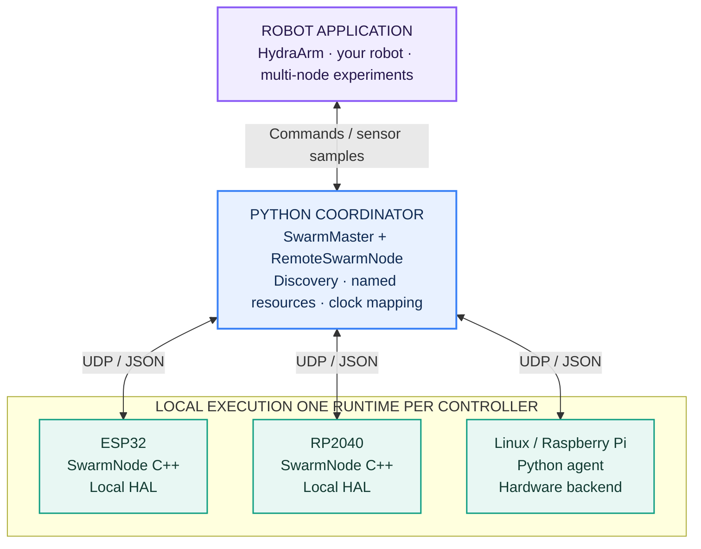
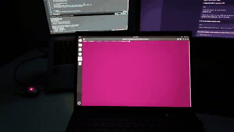

<h1 align="center">OpenSwarm</h1>
<p align="center"><strong>Small controllers. Shared intelligence. Robots built together.</strong></p>
<p align="center">A common hardware interface for robots built from different controllers.<br/>Declare hardware on the board. Build robot behavior in Python.</p>

<p align="center">
  <a href="https://pypi.org/project/openswarm-master/"></a>
  <a href="https://pypi.org/project/openswarm-slave/"></a>
  <a href="https://github.com/raihhann/OpenSwarm/tree/SwarmNode"></a>
  <a href="LICENSE"></a>
</p>

<p align="center">
  <a href="#meet-hydraarm">HydraArm showcase</a> &nbsp;·&nbsp;
  <a href="#quick-start">Quick start</a> &nbsp;·&nbsp;
  <a href="docs/framework_walkthrough.md">Framework walkthrough</a> &nbsp;·&nbsp;
  <a href="#the-vision-from-connected-hardware-to-cooperative-robots">The vision</a>
</p>

---

## Build the robot around the task

A robot should be able to use the controller that fits each job: an ESP32 close to
an actuator, an RP2040 reading local hardware, and a Raspberry Pi exposing Linux
devices. Connecting those pieces should not mean writing a different robot
application for every board.

**OpenSwarm brings them behind one named-resource interface.** Its distributed
hardware abstraction layer connects a Python coordinator to microcontroller and
Linux agents over UDP. Boards declare their sensors, actuators and buses; the host
application decides what the robot does.

> **Declare the hardware. Compose the robot. Evolve its behavior.**
>
> With an unchanged hardware declaration, you can change host-side behavior without
> reflashing every controller. Drivers, local execution and supervision stay on the nodes.

| What you want to do | What OpenSwarm provides |
| --- | --- |
| Combine different controllers | A common command and telemetry contract for MCU and Linux agents |
| Keep device firmware focused | Typed resource declarations and a reusable node runtime |
| Iterate on robot behavior | A Python SDK, discovery, direct-IP connections and a command-line interface |
| Coordinate multiple nodes | Sequenced commands, clock mapping and optional future execution timestamps |
| Extend attached hardware | Built-in registrations, I2C/SPI/UART access and custom callbacks |
| Separate application progress from connectivity | Per-command leases alongside transport keepalives and watchdogs |

Small, affordable controllers matter because weight, power, cost and space are
real design constraints. They can remain useful sensing and actuation resources
while a shared computer handles planning, perception or interaction. OpenSwarm
explores that division through a focused remote-hardware interface.

## One framework, multiple architectures



The application addresses **node + resource name**, not a remote board's pin map.
Each agent owns its hardware descriptors, local driver operations, pending commands
and supervision state. MCU sketches can leave `loop()` empty; the library services
the runtime through its platform task or loop hook.

**OpenSwarm is the framework. HydraArm is one robot built with it.**

## Meet HydraArm

### Four joints. Three controller architectures. One application.

[**HydraArm**](projects/hydra_arm/README.md) is a distributed robotic-arm application
that puts the framework's central idea to work: one robot can combine heterogeneous
controllers while exposing a unified joint interface to its operator.

| Joint | Controller | OpenSwarm node |
| --- | --- | --- |
| Base yaw | ESP32 | `arm_base_esp32` |
| Elbow pitch | RP2040 | `arm_elbow_rp2040` |
| Shoulder pitch + gripper | Raspberry Pi | `arm_shoulder_gripper_rpi` |

HydraArm includes a **browser-based 3D joint-control studio**, a **terminal CLI**,
**episode recording/playback**, and **virtual arm nodes** for trying the application
before connecting the physical controllers. The browser model visualizes commanded
joint targets; it is not independent position feedback.

<p align="center">
  <a href="projects/hydra_arm/Demo.mp4"></a>
  &nbsp;
  <a href="projects/hydra_arm/README.md"></a>
</p>

**[Watch the project video →](projects/hydra_arm/Demo.mp4)** ·
[Browse the host application](projects/hydra_arm/master/) ·
[Browse the controller declarations](projects/hydra_arm/slaves/)

The arm demonstrates composition, not a requirement to use OpenSwarm. The same
resource model can support other robot applications, with their own calibration,
control logic and hardware validation.

## See the basic hardware loop

The ESP32 LED demonstration shows the smallest version of the workflow: a Linux
host controls a named GPIO output and reads Wi-Fi RSSI from a real node.

<p align="center">
  <a href="assets/demo_esp32_led.mp4"></a>
  <br/>
  <em>Real ESP32 demo   click the animation to open the full video.</em>
</p>

## Quick start

### 1. Install the host SDK

In your Python environment:

```bash
python -m pip install openswarm-master
openswarm scan
```

Packages are independently installable:
[**Python host SDK**](https://pypi.org/project/openswarm-master/) ·
[**Linux agent**](https://pypi.org/project/openswarm-slave/) ·
[**Arduino library**](https://github.com/raihhann/OpenSwarm/tree/SwarmNode).
Repository features can be newer than published packages; see the
[release guide](docs/releases.md) when choosing a version.

### 2. Declare an ESP32 node

Install **SwarmNode** using Arduino IDE Library Manager, or use PlatformIO:

```ini
lib_deps =
    raihann/SwarmNode@^0.4.3
```

Upload this example after setting your Wi-Fi credentials. GPIO 2 is the LED on
some ESP32 boards; choose an output pin appropriate for your exact board.

```cpp
#include <SwarmNode.h>

SwarmNode node("esp32_node");

void setup() {
    if (!node.connectWiFi("YOUR_WIFI_SSID", "YOUR_WIFI_PASSWORD")) return;
    node.registerDigitalOutput("led", 2);
    node.registerWiFiRSSI("rssi");
    node.start();
}

void loop() {}  // The node runtime handles communication and local execution.
```

### 3. Control the named resource from Python

Connect the host and board to the same reachable local network:

```python
import time
from openswarm import SwarmMaster

master = SwarmMaster()
node = None
try:
    node = master.connect("esp32_node")  # Or supply ip="192.168.x.x".
    for _ in range(5):
        node.digital_write("led", 1)
        time.sleep(0.5)
        node.digital_write("led", 0)
        time.sleep(0.5)
    print("Wi-Fi RSSI:", node.read("rssi"))
finally:
    try:
        if node is not None:
            node.digital_write("led", 0)
    finally:
        master.close()
```

For a Linux agent, install `openswarm-slave` on the target machine; physical GPIO
requires the appropriate optional hardware dependencies and backend. Follow the
[Linux agent guide](slaves/linux/README.md). For more MCU examples, see
[the library examples](slaves/arduino/SwarmNode/examples/).

### Try the applications without hardware

From a repository checkout:

```bash
python -m pip install -e "master[demo]"
```

**HydraArm:** run the virtual nodes in one terminal and the studio in another:

```bash
python projects/hydra_arm/master/virtual_arm_slaves.py
```

```bash
python projects/hydra_arm/master/hydra_arm_studio.py
```

Open **http://localhost:8090**. The optional fleet demo is available through
[`launch_demo.bat`](launch_demo.bat) or [`launch_demo.sh`](launch_demo.sh) at
**http://localhost:8080**. These virtual environments demonstrate application and
protocol behavior, not physical robot motion.

## Engineering behind the interface

| Capability in the repository | What it means |
| --- | --- |
| Passive discovery + explicit activation | Inspect discovered nodes without automatically commanding every device |
| Sequence ordering | Reject stale or duplicate actuator commands within a session |
| Clock-scheduled commands | Translate a common host target into node-local execution times |
| Application command leases | Expire an actuator command independently of ongoing PING traffic |
| Sensor freshness + diagnostics | Inspect sample age, errors and selected runtime counters |
| HAL/backend boundaries | Keep platform-specific device operations behind a shared interface |
| Offline benchmarks + regression tests | Exercise protocol, timing, simulation and fault behavior reproducibly |

Scheduling is conditional on arrival time, clock estimation and local servicing;
it is not a hard real-time guarantee. The current execution queue is one pending
slot per actuator, not a buffered trajectory planner. Receive acknowledgements
are not proof of physical execution. See the [wire protocol](docs/protocol.md).

The repository contains HAL implementations for ESP32, RP2040, UNO R4 WiFi,
UNO WiFi Rev2 and Nano 33 IoT, plus a Linux agent. Recorded live-board campaigns
use **ESP32-WROOM-32, Arduino Nano RP2040 Connect and Raspberry Pi**. Implementation
coverage and physical validation are tracked separately; drivers and capabilities
vary by board/backend. Boards without the required network support need a port.

For declarations covering motors, servos, GPIO, PWM, sensors, buses and custom
devices, see the [hardware registration reference](docs/hardware_reference.md).
OpenSwarm is a focused remote-HAL approach; it does not claim to replace ROS 2 or
micro-ROS, or that inexpensive controllers cannot participate in those ecosystems.

## The vision: from connected hardware to cooperative robots

**Today:** a central application composes nodes, sends commands and receives
telemetry. Those nodes may belong to one robot, as in HydraArm, or to several
robots coordinated by an application.

**The direction:** a common language through which two robots or a swarm can
exchange capabilities, observations, task assignments and progress to complete a
shared task. Imagine robots dividing an inspection route or coordinating a shared
object-handling task while retaining controllers suited to their individual roles.

That robot-to-robot task protocol is future work. The current framework provides
the hardware-access foundation and master-mediated communication; decentralized
negotiation, allocation and peer-to-peer execution are not implemented capabilities.

## Explore, reproduce, contribute

| Start here | What you will find |
| --- | --- |
| [Framework walkthrough](docs/framework_walkthrough.md) | How declarations, commands and telemetry fit together |
| [HydraArm](projects/hydra_arm/README.md) | Application setup, joint allocation and wiring |
| [Master SDK](master/README.md) / [Linux agent](slaves/linux/README.md) | Package-specific usage |
| [Hardware API](docs/hardware_reference.md) / [protocol](docs/protocol.md) | Registrations, wire format and execution semantics |
| [Software benchmarks](benchmarks/REPORT.md) | Host measurements, declared simulations and reproducibility details |
| [Hardware validation](benchmarks/hardware/README.md) / [saved campaigns](benchmarks/hardware/results/README.md) | Probe procedures and retained observations |
| [Development workflow](docs/development.md) / [releases](docs/releases.md) | Branches, tests and package publishing |
| [Roadmap and backlog](docs/roadmap.md) | Controller coverage, reliability, safety and authentication work |

```bash
python -m pip install -e "master[demo]" -e slaves/linux
python -m unittest discover -s tests -t . -v
python benchmarks/run_benchmarks.py
```

Software benchmarks distinguish host processing from simulated timing and live
hardware observations. They do not establish physical Wi-Fi capacity or complete
MCU memory consumption. Hardware campaigns retain failures as well as successes.

Core code lives in `master/` and `slaves/`, applications in `projects/`, tests in
`tests/`, and validation tools/evidence in `benchmarks/`. Use **`dev`** for ongoing
work and **`main`** for reviewed changes; **`SwarmNode`** is the generated Arduino
distribution branch. Contributions that improve ports, drivers, measurement or
robot applications are welcome through issues and pull requests.

> [!IMPORTANT]
> Use physical nodes on a trusted, isolated network. The current UDP protocol is
> unauthenticated and unencrypted. Software watchdogs and command leases request
> type-specific stopping; they are not an independent emergency-stop system.
> Mechanical limits, actuator power and physical stopping need application-specific validation.

---

## Built by

**Mohammed Raihan Soniwala** · [GitHub @raihhann](https://github.com/raihhann) ·
[Email](mailto:raihann.eu@gmail.com)

Interested in the framework, a robotics application, or an engineering collaboration?
Explore HydraArm, try the examples, or get in touch.

Released under the **[MIT License](LICENSE)**.
