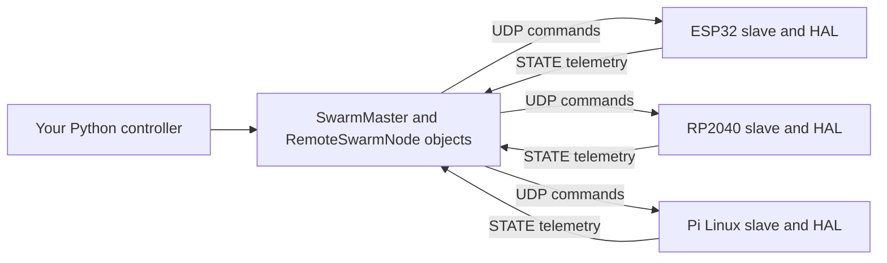

# How OpenSwarm works

Start with one LED and follow one command end to end. Then add clocks and timing.
This guide describes the current implementation, including the prepared master
0.2.1 patch. It distinguishes the real framework from its test instruments.

## 1. The three parts

| Part | Runs where | Responsibility |
| --- | --- | --- |
| SwarmMaster | Laptop/central computer, Python | Discover nodes, send commands, receive telemetry, maintain keepalives |
| RemoteSwarmNode | Python object on that same computer | Represent one remote board, expose drive/servo/GPIO APIs, track sequence and timing |
| Slave SwarmNode + HAL | Microcontroller C++, or Linux agent on Pi | Resolve names to hardware, execute commands, read sensors, apply local scheduling/stop rules |



The HAL is the code that actually accesses GPIO, PWM, buses or drivers on a
particular board. The Python controller chooses what the robot should do; the
slave still performs necessary local execution, sensor polling and supervision.
An empty user loop does not mean that no code runs on the board.

## 2. What registration does

Your ordinary Arduino LED example contains:

```cpp
SwarmNode node("esp32_node");
node.registerDigitalOutput("led", 2);
```

This declares a lookup entry: name `led`, type DIGITAL_OUT, pin 2. The HAL
configures the output. It does not blink the LED by itself. Registering a servo
similarly records its type and pin; you do not need to write its driver yourself.

Three different names must not be confused:

- Node ID `esp32_node` identifies a board.
- Actuator name `led` identifies a registered device on that board.
- GPIO number `2` identifies an electrical pin under the board's numbering scheme.

The same actuator name can exist on different boards because the node is selected
first. GPIO numbering and electrical capabilities still differ between boards.

## 3. What happens after node.start()

The slave listens on UDP 4210 by default, broadcasts HELLO discovery on 4211 and
sends STATE telemetry to the current command sender's endpoint. HELLO describes
the board's node ID, command port and registered names. STATE carries uptime,
sensor values and optional sequence/supervision counters.

ESP32 runs the framework in a background task. Nano RP2040 Connect uses a thread.
Some other boards use the library's Arduino loop hook. Include SwarmNode.h last
because that hook renames the sketch's loop token on those platforms. Blocking
callbacks/drivers can delay framework work; an empty sketch loop does not make
all execution independent or hard real time.

## 4. Follow your LED command

The laptop executes, using the current node ID/IP:

```python
from openswarm import SwarmMaster

with SwarmMaster() as master:
    board = master.connect("esp32_node", ip="YOUR_ESP32_IP")
    board.digital_write("led", 1)
    input("LED requested ON; press Enter to switch it OFF")
    board.digital_write("led", 0)
```

connect sends a PING and waits for valid telemetry. digital_write produces a JSON
ACT command like `{"cmd":"ACT","name":"led","value":1,"seq":2}`. The actual
seq depends on any preceding/background traffic; do not hard-code it in normal use.

RemoteSwarmNode serializes/sends it; the slave parses it, checks sequence order,
finds `led` in its descriptors and calls the board HAL's digital-output operation.
Changing your Python controller does not require reflashing firmware when the
registered hardware and firmware capabilities stay the same.

`board.pin_write(2, 1)` is a different route: a raw PIN command bypasses the named
actuator lookup. Raw PIN does not carry the per-actuator lease/scheduling contract.

## 5. Why sequence numbers exist

UDP can lose, duplicate or reorder packets. If a new target arrives before an
older target, the slave should not later apply the old target. The sender assigns
seq values 1..32767, wrapping back to 1. The slave accepts forward modular steps
of 1..16383; duplicates/older ACT and PIN packets increment seq_drop and are ignored.

PING and STOP use the same watermark when sequenced. A delayed PING still gets a
reply but cannot rewind ordering. A stale STOP still requests stopping and clears
pending commands. STATE ack is the receive watermark, **not proof of execution**.

Ordering is scoped to a session. Watchdog recovery and changed sender endpoints
reset ordering; this is why switching UDP sockets during testing was undesirable.
There is no authenticated exclusive controller owner. Another master can interfere.
Legacy unsequenced commands bypass ordering. This is not security replay protection.

## 6. What synchronized actuation actually means

Board uptime clocks begin at different boot times. The master estimates each
clock's offset relative to its own monotonic clock, then translates a common
future target into each slave's clock. at_ms carries the low 15 bits of that target.

```python
master.sync_actuate([
    (base, "servo", 90),
    (elbow, "servo", 120),
], lead_ms=30)
```

Each actuator has one pending slot. A newer accepted command can replace that
slot; it is not a complete buffered trajectory planner. The slave executes when
its runtime services the due target. Commands already late, or outside the
supported 1..1000 ms scheduling horizon, execute immediately.

sync_actuate sends separate packets; it is not an atomic distributed transaction.
Network arrival, clock error, quantization and service delay determine real skew.
Master 0.2.1 refuses unknown/expired clocks before sending the batch rather than
silently turning a scheduled batch into immediate commands.

## 7. Clock estimation and its limits

The master sends PING at host time s and receives STATE at r with slave uptime u.
The 0.2.1 clock estimate uses PING samples, not delayed ordinary command ACKs. It
selects the lowest-delay recent sample and reports a conditional offset interval
`[u-r, u+1-s]` in milliseconds. The +1 accounts for uptime timestamp quantization.
snapshot returns one coherent view of sensors, uptime, counters and clock quality.

The midpoint is an estimate, not ground truth. Asymmetric delays, drift and clock
resolution limit it. The current uncertainty propagation declares a 200 ppm drift
allowance; actual clock error must still be calibrated. The experiment keeps
negative point estimates visible and reports causal-interval violations.

Using the same clock map to schedule and measure cannot independently demonstrate
physical synchronization accuracy. GPIO edge capture with a calibrated shared
clock would provide stronger evidence than this software-only time conversion.

## 8. PING, leases and STOP solve different problems

| Mechanism | What it observes | What it does |
| --- | --- | --- |
| PING keepalive | Transport path remains active | Requests telemetry and refreshes transport liveness |
| 500 ms watchdog | Slave has not received transport traffic | Applies type-specific stop behavior and resets ordering |
| lease_ms | An actuator command's execution lease expires | Requests stopping that actuator even if transport remains online |
| STOP | An explicit command arrived | Cancels pending work and applies type-specific stop behavior |

Neither watchdog nor lease is an independent hardware safety controller. A blocked
runtime or driver can delay enforcement. Servo hold/release, motor power and
mechanical stopping are different physical behaviors requiring driver-specific tests.
Ordinary DIGITAL_OUT, raw PIN and bus writes are not all automatically zeroed by
the current stop path. Do not assume the LED example proves emergency-stop coverage.

## 9. What applyProbe is doing

Normal hardware uses registerDigitalOutput/registerServo/etc. applyProbe is a
CUSTOM actuator callback in the experiment fixture. It counts executions and stop
callbacks, records local timestamps and changes an unloaded GPIO. The test runner
reads those counters through custom sensors to check whether commands executed.

It is measurement instrumentation. Its results cover that custom path, not every
standard driver. No user should need applyProbe merely to operate a registered LED.
The next driver-validation work should exercise normal registration APIs separately.

## 10. What exists today and what remains open

The working architecture is master-mediated hardware control with telemetry,
sequence ordering, bounded pending slots and local supervision. Peer-to-peer task
coordination, consensus, decentralized planning and autonomous swarm behavior are
future work. ROS compatibility/resource comparisons require matched measurements;
they do not follow simply from having a small JSON protocol.

For the current patch, software regressions are followed by the bounded campaign
in [hardware_rerun.md](hardware_rerun.md). Resolve unexplained resets/delivery
failures, document board/build identities and scope timing claims to available
measurements. These are concrete readiness gates; no fixed feature/test count
automatically establishes research novelty or conference acceptance.

## Code reading order

1. [Master SDK](../master/openswarm/master.py): connection, dispatch, receive and heartbeat loops.
2. [Remote node](../master/openswarm/node.py): command methods, sequencing, clock filter and snapshots.
3. [Wire contract](protocol.md): packet fields, ordering, timing and compatibility.
4. [Arduino runtime](../slaves/arduino/SwarmNode/src/SwarmNode.cpp): registration, parser dispatch, pending commands and stops.
5. [Arduino HALs](../slaves/arduino/SwarmNode/src/hal): actual board drivers.
6. [Linux runtime](../slaves/linux/openswarm_slave/node.py): matching behavior on the Pi.
7. [Hardware runner](../benchmarks/hardware/validate_node.py): experiments, not production robot logic.
